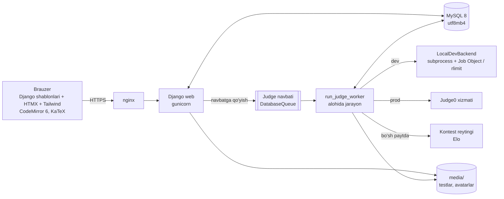
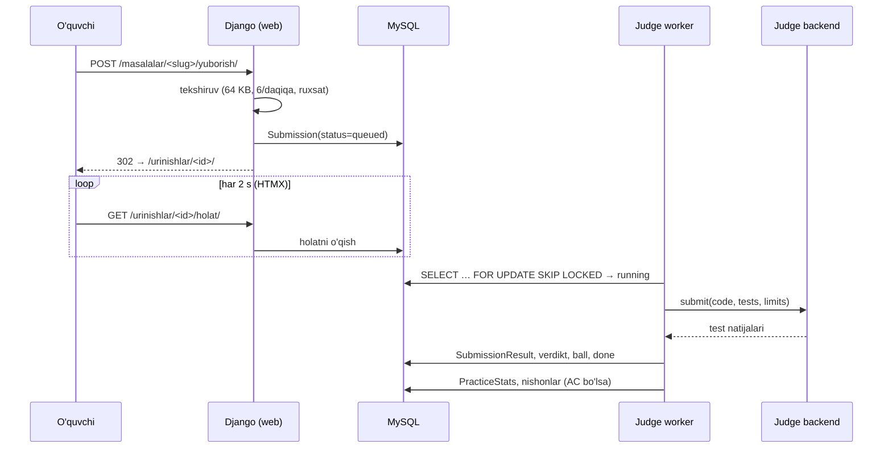
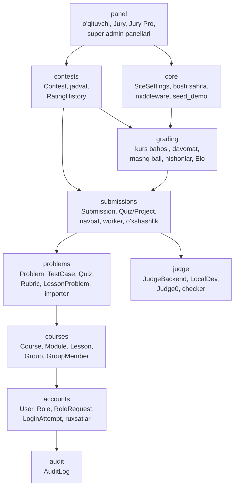

# Arxitektura

## Umumiy sxema



**Asosiy qoida:** foydalanuvchi kodi hech qachon Django web-jarayonida bajarilmaydi. Web faqat yechimni saqlab
navbatga qo‘yadi; worker uni judge backend orqali tekshiradi, natijani bazaga yozadi, sahifa esa HTMX bilan
har 2 soniyada holatni so‘raydi.

## Yechim hayot sikli



## Ilovalar



| Ilova | Vazifasi |
|---|---|
| `accounts` | Foydalanuvchi (5 darajali rol), rol so‘rovlari, ruxsat vositalari, kirish cheklovi, 2FA sahifalari |
| `audit` | Muhim harakatlar jurnali (`log_action`) |
| `courses` | Kurs → modul → dars (48), guruhlar |
| `problems` | Vazifalar banki (code/quiz/project), testlar (media’da), import/verify buyruqlari, seed kontent |
| `judge` | Judge adapterlari va chiqishni solishtirish; Django modellarisiz |
| `submissions` | Yechimlar, navbat, worker, quiz va loyiha baholash, statistika, ko‘chirmachilik |
| `grading` | Kurs bahosi (musobaqa reytingidan alohida), davomat, mashq bali, seriya, nishonlar, Elo algoritmi |
| `contests` | Kontestlar (ICPC/IOI), jadval, muzlatish, reyting tarixi |
| `core` | Sayt sozlamalari, bosh sahifa, xavfsizlik middleware’lari (CSP, 2FA, parol), `seed_demo` |
| `panel` | Rol panellari (UI) |

## Ma’lumotlar modeli (asosiy)

```mermaid
erDiagram
    USER ||--o{ SUBMISSION : yuboradi
    USER ||--o{ GROUPMEMBER : a'zo
    GROUP ||--o{ GROUPMEMBER : ""
    COURSE ||--o{ MODULE : ""
    MODULE ||--o{ LESSON : ""
    COURSE ||--o{ GROUP : ""
    LESSON ||--o{ LESSONPROBLEM : ""
    PROBLEM ||--o{ LESSONPROBLEM : ""
    PROBLEM ||--o{ TESTCASE : ""
    PROBLEM ||--o{ QUIZQUESTION : ""
    PROBLEM ||--o{ RUBRICCRITERION : ""
    PROBLEM ||--o{ SUBMISSION : ""
    SUBMISSION ||--o{ SUBMISSIONRESULT : ""
    CONTEST ||--o{ CONTESTPROBLEM : ""
    CONTEST ||--o{ CONTESTPARTICIPANT : ""
    CONTEST ||--o{ SUBMISSION : ""
    CONTEST ||--o{ RATINGHISTORY : ""
    USER ||--|| PRACTICESTATS : ""
    USER ||--o{ USERBADGE : ""
```

## Kengaytirish nuqtalari

- **Yangi til (C++, JS):** `judge.types.Language` + `judge0.LANGUAGE_IDS`; LocalDevBackend faqat Python (dev).
- **Redis/Celery navbati:** `submissions.queue.JudgeQueue` ni amalga oshiruvchi klass va `JUDGE_QUEUE` sozlamasi.
- **Yangi kurs/yo‘nalish:** `Course` + `courses/seed_data.py` uslubida data migratsiya; vazifalar — `import_problems`.
- **Tarjimalar (ru/en):** barcha shablon matnlari `` da; `LANGUAGES` va `locale/` ga qo‘shish.
- **Tailwind build:** CDN o‘rniga build — keyin CSP’dan `style-src 'unsafe-inline'` olib tashlanadi.
